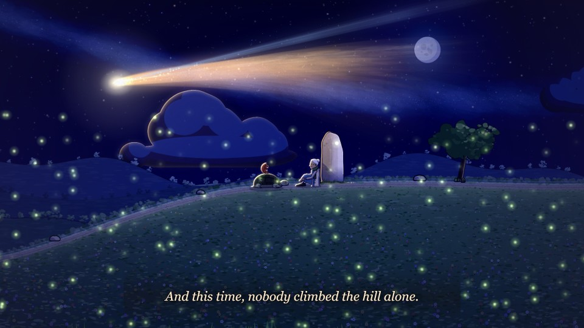
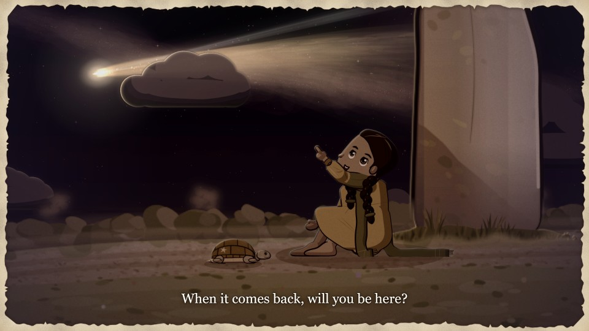
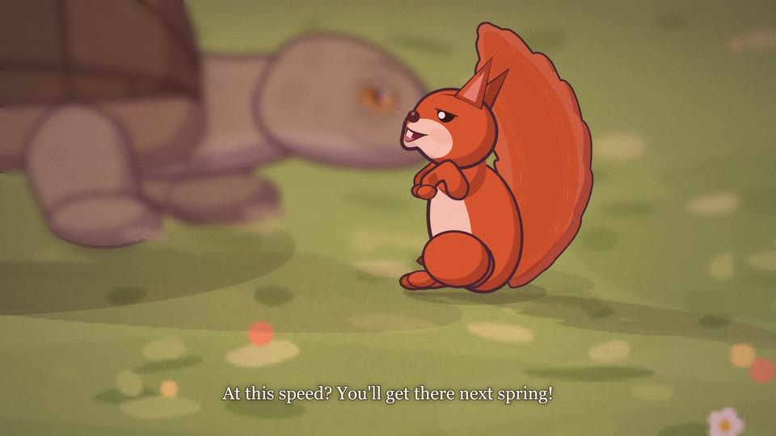
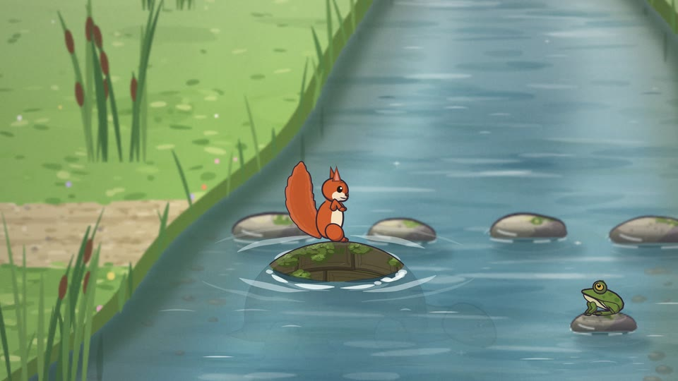
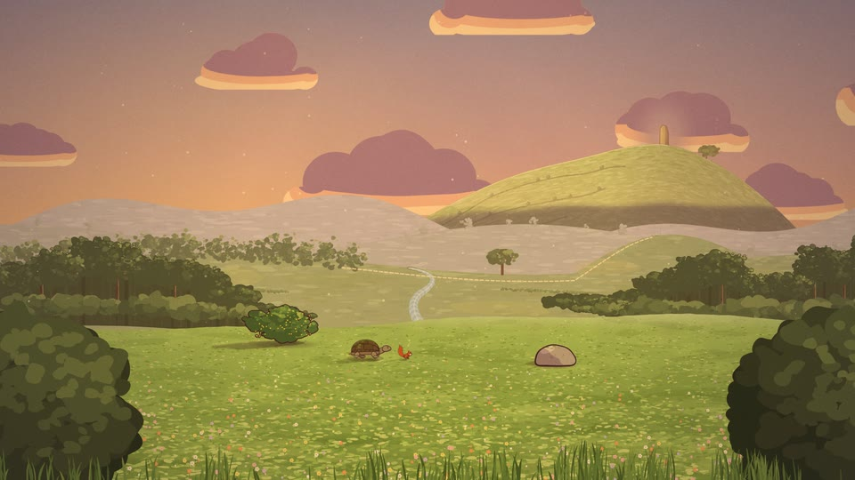
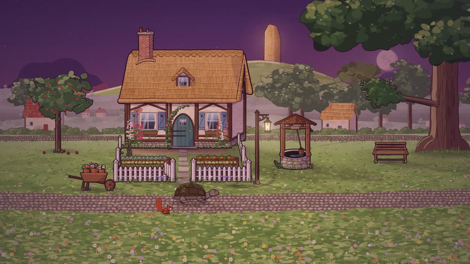
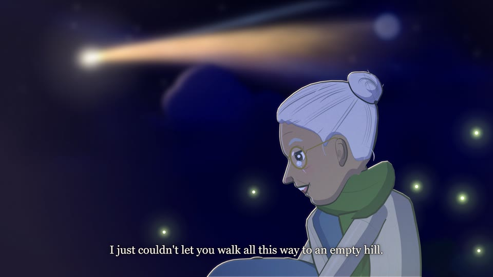
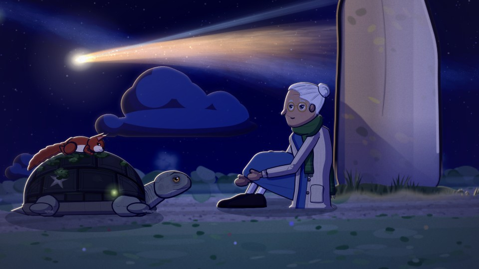

# cinecode

cinecode turns a storyboard written as JSON into a finished animated film: painted sets, animated characters, camera
work, captions, music, sound effects and a mastered mix, rendered to an MP4 with subtitles. Everything is drawn and
synthesized by code, with no image or music models and no stock assets. Only the voices come from a model (Gemini
TTS); they are checked and cached on disk, so a voiced film re-renders the same way every time without a network.



Watch the films and read the docs at **[zakaria.dev/cinecode](https://zakaria.dev/cinecode/)**.

## How a film is made

1. **Screenplay.** `films/<slug>/screenplay.md`: logline, characters (rig, look, voice), locations and times, a music
   plan, then scenes and shots with their lines.
2. **Storyboard.** `films/<slug>/film.json`: the cast, the sets, and for each scene where everyone starts, then each
   shot's camera and its beats (say, walk, look, gesture, sound, music…). See [docs/storyboard.md](docs/storyboard.md).
3. **Check.** `cinecode check` validates every field and lists every problem with its path.
4. **Voice.** `cinecode voice` generates each line with Gemini TTS, transcribes it, retries takes that don't match
   and caches the result. Shot lengths now come from the real takes.
5. **Contact sheets.** `cinecode sheet` draws the middle frame of every shot; strips of frames show the motion. Look,
   fix `film.json`, look again.
6. **Lint.** `cinecode lint` checks staging and editing: floating feet, speakers out of frame, heads cut by the frame
   edge, captions over faces, jump cuts, continuity across cuts, and more, with a fix tried for each framing fault.
7. **Music and mix.** `cinecode mix` composes the score and mixes it with the dialogue, effects and ambience.
8. **Animatic.** `cinecode animatic`: a quick preview at half size and 12 fps, with sound.
9. **Render.** `cinecode render`: full HD in parallel, with an `.srt` and soft subtitles, checked with ffprobe.

## What's in the engine

- **Rigs.** 14 characters, inked and cel-shaded: human, hare, tortoise, fox, owl, squirrel, songbird, mouse,
  hedgehog, badger, deer, frog, beetle and butterfly. Each has poses, gaits, gestures and expressions; the human has
  ages, builds, hair and clothes. Two things as well: a `planet` (eleven worlds, Saturn's rings at their true radii)
  and a `telescope`. [docs/cast.md](docs/cast.md)
- **Sets.** 8 painted locations (meadow, forest, stream, wayside, valley, hill, village, and space) with parallax
  layers, props that sort in depth with the actors, named anchors (ground, surfaces, perches, hollows), walkable
  regions with routing around obstacles, water and stepping stones, eight times of day with sun shadows (or a kit's
  own: space has one), and an ambience bed. [docs/sets.md](docs/sets.md)
- **Camera.** Shot sizes from establishing to extreme close-up framed on the actors you name, a point of the set, or
  part of a subject (a crop or a `focus`); push-in, pull-out, pan, track, tilt and handheld moves, and moves through
  depth (a dolly, a dolly-zoom) among things in front of and behind each other; lead room, headroom and caption-safe
  framing; depth of field on close shots; dissolves between scenes. [docs/storyboard.md](docs/storyboard.md#camera)
- **Acting.** Walks, runs, hops and flights along routes; fliers that hover; looks, eyelines and listeners who keep
  watching the speaker; expressions that change behind a blink; lip sync from the voice's envelope; blinking and
  breathing; riding on another character; wading.
- **Voices with QA.** 30 Gemini voices, each line's direction kept short, every take transcribed and held to a word
  error rate of 0.2, up to three takes, cached by content. [docs/sound.md](docs/sound.md#voices)
- **Music.** A procedural score in ten moods, phrased in four-bar periods, voice-led, arranged by intensity, with a
  film-wide motif stated on a chosen instrument and stings placed on story beats.
  [docs/sound.md](docs/sound.md#music)
- **Sound and mix.** 39 synthesized effects, automatic footsteps by surface, eight ambience beds, dialogue
  normalization, music ducking and a two-pass loudness master to −16 LUFS. [docs/sound.md](docs/sound.md)
- **Effects.** Built-in fields and one-shots (dust, splashes, sparkles, leaves, rain, fireflies, motes, mist) and
  nine built-in custom effects for skies and space (a star seen by eye, the Sun's glow, a star stream, a telescope's
  eyepiece, light crossing to a planet, an orbit, a row of Earths across a planet, its moons, drifting debris).
  [docs/effects.md](docs/effects.md#built-in-effects)
- **Lint.** Sixteen staging and editing rules with an illustrated report; each framing fault comes with a camera
  change or staging that was tried on the recompiled film, and a warning kept on purpose is marked on its shot with
  the reason. [docs/lint.md](docs/lint.md)
- **Parallel render.** The frames are split between worker processes (by default one fewer than the CPU cores),
  each with its own x264 encoder, and the parts are joined without re-encoding.
  [docs/rendering.md](docs/rendering.md)
- **Your own code.** A film's `custom.mjs` adds custom drawing beats, scene overlays, sounds, rigs and kits; its
  `rigs/`, `kits/` and `effects/` folders (or a project's `cinecode/` folder, shared by its films) hold them as files
  of their own, each with a gate (`verify-rig`, `verify-kit`, `verify-effect`) that checks it and draws review images.
  [docs/effects.md](docs/effects.md)

## Requirements

- Node.js 20 or newer
- `ffmpeg` and `ffprobe` on `PATH` (for the mix master, the animatic and the render)
- `@napi-rs/canvas` (the only npm dependency; `npm install`)
- `GEMINI_API_KEY` in the environment, only to voice lines. Everything else runs offline.

## Quickstart

```sh
npm install
node bin/cinecode.mjs new films/my-film      # a starter film: film.json, screenplay.md, custom.mjs
node bin/cinecode.mjs check films/my-film    # valid?
node bin/cinecode.mjs plan films/my-film     # the shot list with times
node bin/cinecode.mjs sheet films/my-film    # → films/my-film/out/sheet.jpg
node bin/cinecode.mjs animatic films/my-film # → films/my-film/out/animatic.mp4
```

The starter is one scene of six shots in the meadow (a girl wakes a sleepy hare and races him to the pond); it passes
`check` and `lint` and makes an animatic before it is voiced (the unvoiced lines are left out of the sound). With a key
set, `node bin/cinecode.mjs voice films/my-film` voices it and `node bin/cinecode.mjs render films/my-film` renders
`films/my-film/out/my-film.mp4`. Edit `film.json` from there; [docs/storyboard.md](docs/storyboard.md) lists every
field.

## The demo: Seventy-Six Summers

`films/seventy-six-summers/` is a 3:47 film made with cinecode: 12 scenes, 56 shots, 56 voiced lines. A
hundred-year-old tortoise has one day to cross the valley and keep a promise he made to a six-year-old girl the last
time the comet came, with a squirrel riding on his shell. Its screenplay, storyboard, custom effects and voice cache
are all in the folder, so it renders without a key:

```sh
node bin/cinecode.mjs render films/seventy-six-summers
```

| | |
|---|---|
|  |  |
|  |  |
|  |  |
|  |  |

## Install as a Claude Code plugin

The repository is a Claude Code plugin and its own marketplace. In Claude Code:

```
/plugin marketplace add zakariaf/cinecode
/plugin install cinecode@cinecode
```

(or, on Claude Code 2.1.275 or later, in one step: `/plugin install cinecode --marketplace zakariaf/cinecode`).
Installing copies the plugin and its one npm dependency, `@napi-rs/canvas`. It brings four skills (`cinecode`: idea or
screenplay → film; `build-rig`, `build-kit`, `build-effect`: a character, place or effect the engine doesn't have,
each through its gate) and puts the `cinecode` command on Claude's PATH. Open Claude Code in any folder and ask for a
film; the first run checks Node 20+, ffmpeg and the drawing library (`cinecode setup` installs it if it is missing).
Films go in `films/<slug>/` of that folder, and rigs, kits and effects shared by its films in `cinecode/`. Voicing
needs `GEMINI_API_KEY`; everything else runs offline.

## Make a film with Claude Code

The repository includes a Claude Code skill, [.claude/skills/cinecode/SKILL.md](.claude/skills/cinecode/SKILL.md), with
the working method used for the demo: writing the screenplay, translating it to `film.json`, voicing and checking
takes, the contact-sheet review loop, custom effects, and the final render. Open Claude Code in this repository and
ask for a film ("make a two-minute animated film about a fox who is afraid of the dark"), or point it at a screenplay
of your own. The skill's `references/` hold quick tables of rigs, kits, built-in effects, voices and review
checklists, and its `scripts/` print what the commands don't: live inventories of rigs, kits (with every prop's
extent) and effects, the warnings
`check` doesn't show, every beat's start and end and the marks' times (`timeline.mjs`), what each voice take says
with its length and pauses (`takes.mjs --all`), and the score's level per shot with any quiet holes (`levels.mjs`).

## Repository layout

```
bin/cinecode.mjs            the command line (bin/cinecode: the same as a bare command, on the plugin's PATH)
engine/
  core/                     shared helpers: seeded random, geometry, ink and cel-shading style
  paint/                    brushes, skies, nature, scenery, water, buildings, planets
  cast/                     the rigs (one file each) and the rig framework
  set/                      the set framework and the kits in set/kits/
  effects/                  the built-in custom effects (one file each, used by name like a film's own)
  film/                     loading and validation, compile (storyboard → timed plan), camera, actors, frame drawing, grades
  audio/                    voices (Gemini TTS + QA + cache), music, synthesis, effects, ambience, the mix
  lint/                     the staging and editing checks and their report
  render/                   CLI commands, contact sheets, parallel encoding, subtitles
films/
  seventy-six-summers/      the demo film
  glim/                     a 27 s film a fresh agent made from one sentence with the skill
  kite/, strawberry-race/,
  storm-shelter/            three ~35 s films, each made by a fresh agent from one sentence
  _test/                    a small film used by the tests
templates/                  what `cinecode new` copies: film.json, screenplay.md, custom.mjs
docs/                       the reference
test/                       node:test suites
.claude/skills/             the Claude Code skills: cinecode, build-rig, build-kit, build-effect (each build skill with a starter)
.claude-plugin/             plugin.json and marketplace.json: the repository as a plugin and its marketplace
DESIGN.md                   the module contracts
```

## Testing

```sh
npm test                          # every suite: node --test test/*.test.mjs
node --test test/render.test.mjs  # one suite
```

The tests need no network and no API key (the voice tests mock Gemini). Tests that run ffmpeg are skipped when it
isn't installed.

## Licence

MIT, © 2026 Zakaria Fatahi. See [LICENSE](LICENSE).
