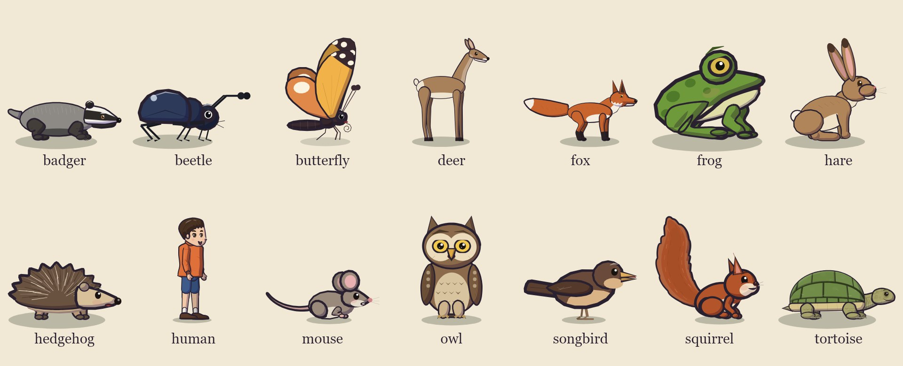
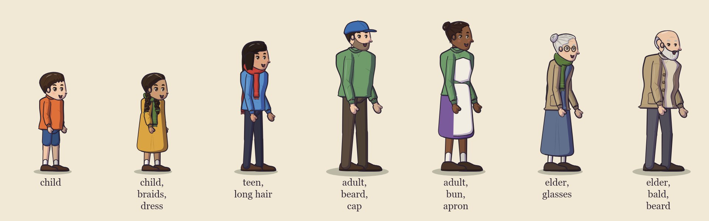

# The cast: rigs

Every actor in a film is an instance of a **rig**: a character drawn by code in the hand-inked, cel-shaded look, with
named poses, gaits (walk cycles), gestures and facial expressions. A film's `cast` picks a rig for each actor and sets
its look with `params`:

```json
"cast": {
  "pebble": { "rig": "tortoise", "name": "Pebble", "voice": "pebble", "scale": 1.35,
              "params": { "shell": "#4b4630", "moss": "#6e8b3d", "star": 0.35, "lids": 0.3 } },
  "nell":   { "rig": "human", "name": "Nell", "voice": "nell",
              "params": { "age": "elder", "build": "slight", "hairStyle": "bun", "glasses": "#b08a3a", "scarf": "#5e7b3f" } }
}
```



To see every pose, gait phase, gesture key frame and expression of a rig, labelled:

```sh
node bin/cinecode.mjs cast-sheet hare,human          # → out/cast-sheet.jpg
node bin/cinecode.mjs cast-sheet films/my-film      # every rig, including the film's own custom rigs → films/my-film/out/
```

The rig lists below come from the code (`engine/cast/*.mjs`). The skill's inventory script prints the same live
lists as Markdown: `node .claude/skills/cinecode/scripts/inventory.mjs cast`.

## What every rig has

| | meaning |
|---|---|
| size | `height` (top to feet) and `width` (body length) in units at scale 1. On screen an actor is `units × set scale × cast scale` world pixels; the set scale grows toward the camera (about 1.3 on most kits' main lane). |
| speeds | world units per second at scale 1, per gait. A beat's `speed` multiplies it. |
| poses | named still poses: `"pose": "sit"` on a scene actor, `{ "do": "pose", "pose": "alert" }`. Pose changes blend smoothly. |
| gaits | walk cycles used by moves: `walk`, `run`, and rig-specific ones (`trot`, `hop`, `scurry`, `fly`, `glide`), chosen with a move's `gait`. Feet plant on the ground while the body moves. |
| gestures | short motions with a fixed length: `{ "do": "gesture", "who": "fox", "name": "bow" }` |
| expressions | `expr` on a scene actor, a `say` line, an `emote`, `pose` or `set` beat |
| params | the look: colours (any CSS hex colour) and a few rig-specific switches |

Every actor also gets **idle life** without being asked: it breathes, blinks every few seconds (seeded, so every render is
the same), glances at whoever starts speaking, and moves its mouth from the voice's loudness while it speaks.

`perch` rigs (owl, songbird, squirrel, butterfly) can stand on a set's `perch` anchors (branches); `flies` rigs (owl,
songbird, butterfly) can `fly`. Any actor can carry a rider ([riding](storyboard.md#riding)); the tortoise has a
riding point on its shell, other rigs carry riders on the top centre of their drawing. In water, only the frog may
stand without wading (lint `in-water`).

**Cast scale vs. size.** Use the cast's `scale` (0.1–10) to make one actor bigger or smaller than the rig's default.
The framing, routing and lint all account for it.

## Expressions

The animal rigs share eleven expressions:

| expression | face |
|---|---|
| `neutral` | relaxed, a slight smile |
| `happy` | smile, raised brows, cheeks up |
| `laugh` | eyes closed in a smile, mouth open |
| `sad` | lids lowered, brows up in the middle, frown |
| `surprised` | eyes wide, brows high, round open mouth |
| `angry` | slanted brows down, narrowed eyes, frown |
| `sleepy` | heavy lids |
| `smug` | half-lidded, one-sided smile |
| `worried` | brows up in the middle, a small frown |
| `scared` | eyes wide, small pupils, mouth open |
| `determined` | brows down, set mouth |

The owl adds `one-eye`. The human has its own set: `neutral`, `happy`, `sad`, `surprised`, `angry`, `sleepy`,
`worried`, `laughing`, `curious` (note `laughing`, not `laugh`). An expression a rig doesn't have is a `check`
problem on `emote`, `pose` and `set` beats, and a warning on `say` lines and scene actors.

## human



One parametric rig for children, teens, adults and elders, drawn in a three-quarter side view. Height 141 units
for the default child; the age sets the proportions (an adult is about 215 units, an elder about 205 and a little
stooped). Speeds depend on age and build (a child walks about 92 units/s; an elder walks slower and shorter).

- **poses:** `stand`, `idle`, `idle-weight-shift`, `sit` / `sit-ground` (on the ground; the hips sit behind the
  contact point, where the feet will stand when she gets up), `sit-seat` (on a seat: place her on a surface anchor such
  as the village's `bench_seat`), `crouch`, `kneel`, `lie`, `sleep`, `look-up`, `hands-on-hips`, `arms-crossed`,
  `reach-up`, `carry`, `hold-hand-out`. A direct sit ↔ stand blend goes through a crouch, so she leans over her feet
  as she rises.
- **gaits:** `walk`, `run`
- **gestures** (seconds): `wave` 1.8, `nod` 0.9, `shake-head` 1.1, `shrug` 1.2, `laugh` 1.8, `jump-for-joy` 1.3
  (leaves the ground), `point` 1.3 (follows her eyeline: look `up` first to point at the sky, or at someone to point
  at them), `point-up` 1.3, `point-down` 1.3, `bow` 1.7, `gasp` 1.1, `beckon` 1.7, `clap` 1.4
- **expressions:** `neutral`, `happy`, `sad`, `surprised`, `angry`, `sleepy`, `worried`, `laughing`, `curious`
- **head pitch:** `look` `to` `up` / `sky` / `down` tilts the head; the eyes follow.

**Params.** Colours accept hex (`#3b2a20`) or a name: `red`, `blue`, `green`, `yellow`, `orange`, `pink`, `purple`,
`brown`, `black`, `white`, `grey`, `blonde`, `ginger`, `navy`, `teal`, `cream`, `brass`, `gold`, `silver`, `copper`,
`bronze`, `tortoiseshell`, `steel`, `moss`, `olive`, `ochre`, `mustard`, `rust`, `tan`, `beige`, `khaki`, `maroon`,
`plum`, `lavender`, `sky`, `charcoal`, `ivory`.

| param | values | default |
|---|---|---|
| `age` | `child`, `teen`, `adult`, `elder` | `child` |
| `build` | `slight`, `slim`, `average`, `sturdy` | `average` |
| `height` | multiplier, 0.6–1.5 | 1 |
| `skin`, `eyes`, `hair` | colours | by age |
| `blush` | 0..1 | 0.5 |
| `hairStyle` | `short`, `long`, `ponytail`, `bun`, `braids`, `curly`, `bald`, `cap` | by age (`short`; teens `ponytail`) |
| `beard` | `none`, `short`, `full` (adults and elders only) | `none` |
| `top` | `shirt`, `cardigan` (an open knit cardigan in the `shirt` colour over `under`) | `shirt` (elders: `cardigan`) |
| `shirt`, `under` | colours | by age |
| `bottom` | `trousers`, `shorts`, `skirt`, `dress` | by age (children: `shorts`) |
| `pants` | trousers / shorts colour | by age |
| `dress` | dress colour; also the colour of a skirt | none |
| `dressStyle` | `smock` (loose from a yoke), `fitted` | children `smock`, others `fitted` |
| `hem` | skirt / dress length: 1 = knee, 2 = ankle (0.4–1.95) | by age (elders long) |
| `shoes` | colour, or `null` / `"none"` for bare feet | brown |
| `socks` | colour | cream |
| `scarf`, `glasses`, `hat`, `apron`, `backpack` | `true` (default colour), a colour, or `false` | `false` |
| `scarfLength` | 0.4–2.5 (a child in an adult's scarf trails it) | 1 |
| `tear` | 0..1: a wet highlight on the lower lids | 0 |

## Animal rigs

Params are colours unless noted. Gesture lengths are in seconds; a gesture beat takes that long.

### badger

Height 35 units, length 92. Speeds (units/s at scale 1): walk 36, run 120.

- **poses:** `stand`, `alert`, `sit`, `upright`, `cheer`, `sleep`, `rest`
- **gaits:** `walk`, `run`
- **gestures** (seconds): `nod` 0.8, `laugh` 1.4, `jump` 0.9, `cheer` 1.6, `wave` 1.6, `dig` 1.6, `sniff` 1.4
- **expressions:** the standard eleven
- **params:** `coat` `#8d8a86`, `face` `#f2efe8`, `dark` `#2e2a28`, `leg` `#433e3a`, `claw` `#d8cdb8`

### beetle

Height 7.5 units, length 11. Speeds (units/s at scale 1): walk 11, run 26.

- **poses:** `stand`, `alert`, `sit`, `sleep`, `rest`
- **gaits:** `walk`, `run`
- **gestures** (seconds): `nod` 0.6, `laugh` 1, `jump` 0.6, `wave` 1.2
- **expressions:** the standard eleven
- **params:** `shell` `#2e3a5a`, `leg` `#1e1e28`

### butterfly

Height 17 units, length 10. Speeds (units/s at scale 1): walk 4, fly 80, glide 70. Perches; flies.

- **poses:** `stand`, `sit`, `open`, `alert`, `sleep`, `rest`, `perch`
- **gaits:** `fly`, `glide`, `walk`
- **gestures** (seconds): `nod` 0.6, `laugh` 1, `jump` 0.7, `flutter` 1, `wave` 1
- **expressions:** the standard eleven
- **params:** `col` `#f2b24a`, `col2` `#e0884a`, `tip` `#3a2a30`, `spot` `#fbf3e0`, `body` `#3a2a30`

### deer

Height 143 units, length 100. Speeds (units/s at scale 1): walk 72, run 580.

- **poses:** `stand`, `alert`, `graze`, `sit`, `sleep`, `rest`, `lie`
- **gaits:** `walk`, `run`
- **gestures** (seconds): `nod` 0.9, `laugh` 1.4, `jump` 1.1, `graze` 2.4, `flick` 0.6, `stamp` 0.8
- **expressions:** the standard eleven
- **params:** `coat` `#a8805a`, `belly` `#efe4d0`, `muzzle` `#f2ece0`, `earIn` `#d9b8a0`, `hoof` `#2e2420`, `eye` `#2a1810`, `antler` `#d8c8a8`, `antlers` 0

### fox

Height 83 units, length 92. Speeds (units/s at scale 1): walk 52, trot 148, run 500.

- **poses:** `stand`, `alert`, `sit`, `lie`, `sleep`, `crouch`, `leap`, `rest`, `walk`
- **gaits:** `walk`, `trot`, `run`
- **gestures** (seconds): `nod` 0.8, `laugh` 1.4, `jump` 0.9, `wave` 1.6, `point` 1.4, `sniff` 1.4, `bow` 1.6
- **expressions:** the standard eleven
- **params:** `coat` `#c8642e`, `cream` `#f4ede0`, `sock` `#2b2222`, `eye` `#a8721c`

### frog

Height 19 units, length 24. Speeds (units/s at scale 1): walk 26, hop 26, run 92.

- **poses:** `stand`, `alert`, `sit`, `sleep`, `croak`, `rest`
- **gaits:** `walk`, `hop`, `run`
- **gestures** (seconds): `nod` 0.6, `laugh` 1.2, `jump` 0.9, `croak` 1.2, `catch` 0.7
- **expressions:** the standard eleven
- **params:** `skin` `#6f9a3c`, `belly` `#e0dca8`, `spot` `#4f7a2a`, `sac` `#efe8c0`, `eye` `#d8b84a`

### hare

Height 103 units, length 72. Speeds (units/s at scale 1): walk 46, hop 190, run 640.

- **poses:** `stand`, `sit`, `stretch`, `bunch`, `up`, `mock`, `laugh`, `wiggle`, `offer`, `look`, `yawn`, `sleep`, `alert`, `ready`, `skid`, `slump`, `rest`, `crouch`
- **gaits:** `walk`, `hop`, `run`
- **gestures** (seconds): `nod` 0.8, `laugh` 1.5, `jump` 0.9, `wave` 1.6, `point` 1.4, `yawn` 2, `thump` 0.9, `shrug` 1
- **expressions:** the standard eleven
- **params:** `fur` `#b08559`, `belly` `#efe2c8`, `earIn` `#e8a9a0`, `earTip` `#4a3428`, `nose` `#d97a7a`, `eye` `#3a2412`, `tail` `#f6efe2`

### hedgehog

Height 24 units, length 40. Speeds (units/s at scale 1): walk 18, run 42.

- **poses:** `stand`, `alert`, `sit`, `ball`, `sleep`, `rest`
- **gaits:** `walk`, `run`
- **gestures** (seconds): `nod` 0.7, `laugh` 1.2, `jump` 0.7, `sniff` 1.4, `curl` 2.2, `bristle` 1
- **expressions:** the standard eleven
- **params:** `spine` `#6a5240`, `tip` `#e8dcc4`, `face` `#d8c09a`, `belly` `#c9b08a`, `skin` `#b89878`

### mouse

Height 17.5 units, length 17. Speeds (units/s at scale 1): walk 24, scurry 24, run 80.

- **poses:** `stand`, `sit`, `alert`, `gasp`, `cheer`, `sleep`, `rest`, `idle`
- **gaits:** `walk`, `scurry`, `run`
- **gestures** (seconds): `nod` 0.6, `laugh` 1.2, `jump` 0.6, `wave` 1.4, `point` 1.3, `cheer` 1.4, `gasp` 1.2
- **expressions:** the standard eleven
- **params:** `fur` `#9a8a7c`, `belly` `#e6dccb`, `earIn` `#e8b0b0`, `nose` `#d88a8a`, `paw` `#e3b6a8`, `tail` `#c49a92`, `eye` `#1a1210`

### owl

Height 62 units, length 36. Speeds (units/s at scale 1): walk 22, run 70, fly 220, glide 200. Perches; flies.

- **poses:** `stand`, `alert`, `sit`, `sleep`, `spread`, `hoot`, `rest`
- **gaits:** `walk`, `run`, `fly`, `glide`
- **gestures** (seconds): `nod` 0.8, `laugh` 1.4, `jump` 0.9, `hoot` 1.2, `flap` 1.2, `turn` 1.8, `wave` 1.4
- **expressions:** the standard eleven plus `one-eye`
- **params:** `body` `#8a6a4a`, `belly` `#d9c4a0`, `disc` `#ecdcbc`, `wing` `#7a5a3e`, `beak` `#e0a840`, `eye` `#f2c94c`, `leg` `#cdb48c`, `toe` `#b8955a`

### songbird

Height 24 units, length 30. Speeds (units/s at scale 1): walk 26, hop 26, run 54, fly 190, glide 170. Perches; flies.

- **poses:** `stand`, `alert`, `sit`, `sleep`, `sing`, `spread`, `rest`, `perch`
- **gaits:** `walk`, `hop`, `run`, `fly`, `glide`
- **gestures** (seconds): `nod` 0.6, `laugh` 1.2, `jump` 0.6, `sing` 2, `flap` 1, `peck` 0.8, `wave` 1.2
- **expressions:** the standard eleven
- **params:** `body` `#6a4a3a`, `breast` `#d9b386`, `wing` `#553a2c`, `beak` `#e0ad5a`, `leg` `#8a6a50`

### squirrel

Height 52 units, length 24. Speeds (units/s at scale 1): walk 24, run 165. Perches.

- **poses:** `stand`, `sit`, `hold`, `alert`, `shush`, `sleep`, `flop`, `sprawl`, `rest`, `perch`
- **gaits:** `walk`, `run`
- **gestures** (seconds): `nod` 0.7, `laugh` 1.3, `jump` 0.8, `wave` 1.4, `point` 1.3, `shush` 1.5, `drop` 1.2, `nibble` 1.6
- **expressions:** the standard eleven
- **params:** `coat` `#b4542a`, `cream` `#f0dcc0`, `earIn` `#d98a78`, `nose` `#3a2020`, `eye` `#1a1210`, `tail` 1

### tortoise

Height 50 units, length 96. Speeds (units/s at scale 1): walk 15, run 34. Has a riding point (`mount`); slow looker (1 s).

- **poses:** `stand`, `alert`, `stretch`, `sit`, `sleep`, `hide`, `droop`, `rest`
- **gaits:** `walk`, `run`
- **gestures** (seconds): `nod` 1, `laugh` 1.5, `jump` 0.9, `wave` 1.8, `hide` 2.4, `stretch` 1.6
- **expressions:** the standard eleven
- **params:** `skin` `#a7a36a`, `shell` `#6f8a46`, `rim` `#d8c58c`, `claw` `#e8e0c0`, `eye` `#2a1e16`, `iris` `null`, `seam` `null`, `moss` `null`, `star` 0, `starCol` `#ede6d0`, `lids` 0, `wet` 0


### Rig-specific params

| rig | param | meaning |
|---|---|---|
| deer | `antlers` | 1 draws antlers (0: none) |
| squirrel | `tail` | brush size, 0.4–1.8; above about 1.1 fluffier, below 0.7 flat and thin like a wet paintbrush |
| tortoise | `star` | 0..1 opacity of a pale five-point marking on a rear scute (0: none); `starCol` its colour |
| tortoise | `moss` | a colour for moss patches on the shell, or `null` |
| tortoise | `seam` | scute seam colour (default: a darker shell) |
| tortoise | `lids` | 0..1 resting upper-lid closure (an old animal's heavy lids) |
| tortoise | `wet` | 0..1: darker, glossier shell and skin, with drips falling from the rim |
| tortoise | `iris` | an iris colour (`eye` is then the pupil); `null` = one dark eye |

The tortoise is a slow looker (a look or head tilt takes about 1 s), withdraws its head with the `hide` gesture and
pose, and has a `droop` pose (head lowered, sad). The squirrel's `flop` pose lies over something rounded (a shell, a
branch) with its legs and tail hanging. Change params mid-scene with a `set` beat:
`{ "do": "set", "who": "pebble", "params": { "wet": 0 } }`.

## Adding a rig

A film can bring its own rigs in `films/<slug>/custom.mjs`: export them as `rigs` and use their `kind` in the cast.
The easy way to write one is `makeRig` from `engine/cast/rig.mjs`, which turns a `paint()` function into the full rig
contract: drawing at any position, scale and facing, the ground shadow, bounds for framing and lint, facial
expressions, blinks, talking and head pitch. This example is a complete, working rig:

```js
// films/<slug>/custom.mjs
import { makeRig, mixPose } from '../../engine/cast/rig.mjs';
import { cel, eye, line } from '../../engine/core/style.mjs';
import { ell } from '../../engine/core/lib.mjs';

// Pose fields are plain numbers that paint() reads: here a body drop `by` and a lean `ln` (radians).
const stand = { by: 0, ln: 0 };
const bob = (amp, ph) => ({ ...stand, by: -amp * Math.abs(Math.sin(Math.PI * 2 * ph)) });

const pebblet = makeRig({
  kind: 'pebblet', label: 'Pebblet',
  height: 40, headHeight: 24, width: 36,          // units at scale 1: for framing, routing and lint
  params: { body: '#8fb0c8', eye: '#2a1a14' },
  speeds: { walk: 30, run: 90 }, stride: { walk: 18, run: 40 },
  poses: { stand, sit: { ...stand, by: 5 }, sleep: { ...stand, by: 7 } },
  gaits: { walk: ph => bob(2, ph), run: ph => bob(5, ph) },
  gestures: { nod: { dur: 0.8, at: (u, base) => mixPose(base, { ...base, ln: 0.25 }, Math.sin(Math.PI * u)) } },
  // local units: origin = the contact point, +x = forward, y up is negative, the ground is y = 0
  paint(T, p, F, o) {
    T.save(); T.translate(0, p.by); T.rotate(p.ln);
    cel(T, ell(0, -18, 19, 18 - p.by / 2, 7, 0.5), o.P.body, 1.6, 1, 7);            // body, cel-shaded and inked
    eye(T, 8, -24, 3, 3.6, F.eye, o.P.eye, F.look * 0.3, F.lid, F.tilt);            // expression, blinks, looks
    const m = 2 + 4 * F.open;                                                      // F.open: talk / expression
    line(T, [[6, -13], [10, -13 + m * 0.5 - F.smile * 1.5], [14, -13]], 0.8, { seed: 9 });
    o.out.head = T.map(6, -24); o.out.mouth = T.map(10, -13);                      // anchors for framing and lip sync
    T.restore();
  },
});
export const rigs = [pebblet];
```

```json
"cast": { "pebblet": { "rig": "pebblet", "name": "Pebblet", "voice": "pebblet" } }
```

How it fits together:

- `paint(T, pose, F, o)` draws in **local units**: the origin is the contact point (the feet), +x is forward (the rig
  is mirrored for `face: -1`), the ground is y = 0 and up is negative y. `T` is a 2D context wrapper that also
  records what is drawn, so bounds are exact.
- `pose` is the current pose object: one of `poses`, a gait frame (`gaits.walk(phase)` for phase 0..1 over one
  stride), a gesture frame (`gestures.nod.at(u, base)` for u 0..1), or a blend of them. Pose fields are plain numbers
  that only your `paint` reads. A pose may set `lift` (units above the ground, e.g. a jump).
- `F` is the face for this frame, from the expression, blink and lip sync: `F.eye` (`open`, `wide`, `happy`),
  `F.lid` (0..1), `F.open` (mouth, 0..1; it follows the voice while talking), `F.smile` (−1..1), `F.browY`,
  `F.browT`, `F.tilt`, `F.look` (−1..1 head turn), `F.pitch` (−1..1 head tilt). `eye()`, `brow()`, `cel()` and
  `line()` in `engine/core/style.mjs` draw them in the house style.
- `o.P` holds the params (the rig's `params` merged with the cast's), `o.t` the scene time for secondary motion.
  Set `o.out.head` and `o.out.mouth` with `T.map(x, y)`: the camera composes close-ups on the head, captions avoid
  it, and the mouth is where talking happens.
- `height`, `headHeight`, `width`, `speeds` and `stride` drive framing, routing and walk timing. `stride` is how far
  one gait cycle travels, so feet don't slide.
- Optional: `perch: true`, `flies: true` (with a `fly` gait), `mount(pose, params)` → `[x, y]` riding point,
  `lookTime` (seconds a look takes), `feet(pose)` → contact points (so gestures layered over a walk keep planted feet
  still), `steps: { walk: [0, 0.5] }` (gait phases where a foot lands, for footstep sounds), `expressions` (default:
  the eleven above), `shadowW`, `breathPeriod`.

A rig written without `makeRig` must provide the contract in DESIGN.md §2 (`kind`, `draw(ctx, x, y, s, face, st)`
returning `{ head, mouth, bounds }` and accepting `ctx = null`, `bbox`, `poses`, `gaits`, `gestures`, `expressions`).
Check the result with `node bin/cinecode.mjs cast-sheet films/<slug> <kind>`. A rig used by more than one film
belongs in `engine/cast/<kind>.mjs` (every file there is registered automatically) with a test in
`test/rigs.test.mjs`.
