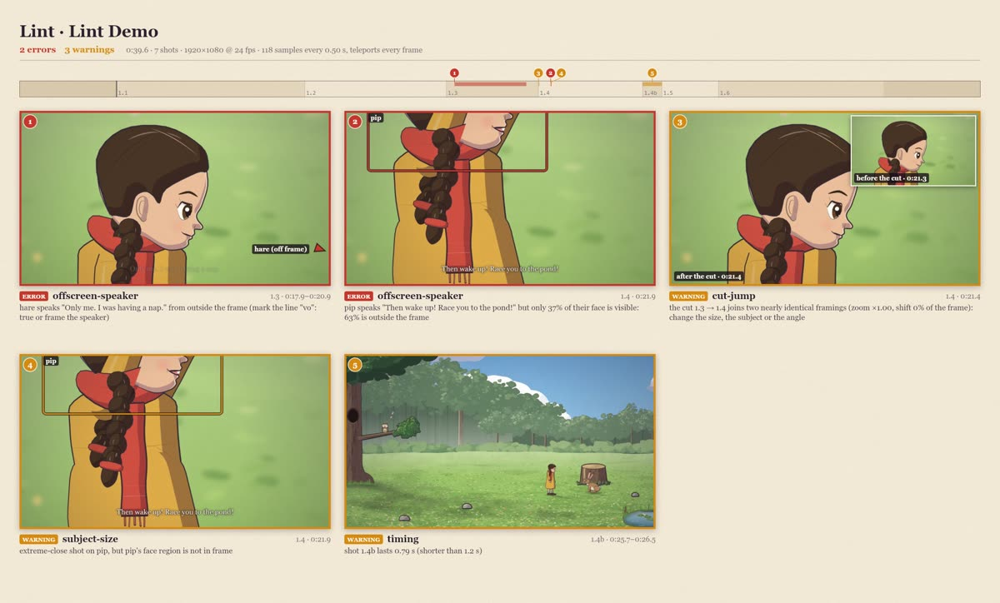

# Lint: staging and editing checks

`lint` finds the things that make a film look wrong even when every frame renders: a character standing on air or
inside a tree, a speaker out of frame, a caption over a face, two near-identical shots cut together.

```sh
node bin/cinecode.mjs lint films/my-film              # → films/my-film/out/lint.json + lint.jpg
node bin/cinecode.mjs lint films/my-film --step=0.5   # sample less often: faster
```

It compiles the film (unvoiced lines use estimated lengths) and samples it on real frame times: every `--step`
seconds (default 1/6), every beat and line boundary, and the first and last frame of each shot. Teleports are checked
on every frame. Hits of the same rule, actor and shot less than a second apart merge into one issue spanning their
time range, reported at its worst moment. The command prints every issue and exits with status 1 when there is at
least one error (warnings alone exit 0):

```
lint     2 errors, 3 warnings → films/lintdemo/out/lint.json, lint.jpg    2.9 s
  error  offscreen-speaker 1.3        0:17.9  hare speaks "Only me. I was having a nap." from outside the frame (mark the line "vo": true or frame the speaker) (17.9–20.9 s)
  error  offscreen-speaker 1.4        0:21.9  pip speaks "Then wake up! Race you to the pond!" but only 37% of their face is visible: 63% is outside the frame
  warn   cut-jump          1.4        0:21.4  the cut 1.3 → 1.4 joins two nearly identical framings (zoom ×1.00, shift 0% of the frame): change the size, the subject or the angle
  warn   subject-size      1.4        0:21.9  extreme-close shot on pip, but pip's face region is not in frame
  warn   timing            1.4b       0:26.1  shot 1.4b lasts 0.79 s (shorter than 1.2 s)
cinecode lint: lint found 2 errors
```

That is the starter film broken on purpose: two extreme close-ups of Pip in a row while the hare speaks, and a
0.8 s shot (`1.4b`). Sampling every 0.5 s, it took 3 s for 40 s of film; at the default step a few-minute film takes minutes.

## The report



`lint.jpg` has a timeline of the film with the shots and where each issue happens, then one tile per issue (up to
48): the frame at its worst moment with the offending boxes, footprints and contact points drawn on it (an arrow at
the edge for anything off frame), its rule, shot, time span and message. Issues about a cut (`cut-jump`, `axis`)
show the frame after the cut with the frame before it as an inset. **Look at it**: a message tells you what was
measured, the tile tells you whether it matters.

`lint.json` holds the same issues for scripts: the film's format and duration, counts, the limits used, each rule's
severity, and `errors` and `warnings` as lists of
`{ rule, severity, t, t0, t1, frame, shot, scene, actor, other, message, box, marks, frames, samples }` (`box` in
frame pixels, `frames` the two times of a cut issue).

## Rules

| rule | severity | catches |
|---|---|---|
| `floating` | error | someone standing on nothing |
| `inside-solid` | error | someone standing inside a solid prop |
| `in-water` | error | someone standing in water who can't swim |
| `collision` | error (warning when a beat brings them together) | two characters drawn into each other |
| `offscreen-speaker` | error | a speaker who can't be seen |
| `subject-size` | warning | a shot's subject too small, too big or missing for the shot size |
| `caption-face` | warning | a caption over a speaker's face |
| `cut-jump` | warning | two near-identical framings cut together |
| `axis` | warning | two talking characters swapping sides across a cut |
| `teleport` | error | someone jumping between two frames |
| `scale` | warning | someone drawn at the wrong size for where they stand |
| `timing` | warning | very short shots, overlapping lines, captions too fast to read |

### floating

An actor that isn't jumping or flying must stand on something: on the ground, inside the set's walkable region (or on
a stepping stone, or in water on a wade route); on the surface, perch or hollow anchor it was sent to (within
max(4, 3 × its scale) px); or on its carrier when riding. It is also floating when its drawing is lifted above its
contact point (by more than 8% of the rig's height) while it is not moving or gesturing, which is a pose or `lift` that
leaves the ground. Fix: use an anchor or a point you have seen inside the walk region on the set sheet; don't hold
lifted poses.

### inside-solid

An actor on the ground whose contact point is inside a solid prop's footprint (a trunk, a stump, a rock: the red
ellipses on the set sheet). Fix: move the target away from the footprint.

### in-water

An actor on the ground or a surface in a water polygon, not on a stone and not on a `"wade": true` route, whose rig
can't swim (only the frog can). Fix: a stone, the bank, or a wading walk ([storyboard.md](storyboard.md#wading)).

### collision

Two actors' footprints overlap at about the same depth (riders and their carriers excepted). It is a warning instead
of an error while a beat brings the two together: a move, place, gesture, pose or custom beat that names both of
them (`"who": "fox", "to": "near:pip"`), from 0.25 s before it to 0.5 s after. Fix: move one along x or to another
depth; `near:<actor>` stops beside someone.

### offscreen-speaker

During a line (not the narrator's and not `vo`), the speaker must be in the scene, on stage, above the water and at
least **60%** visible: of the body in wide and full shots, the waist-up region in a medium shot, head and shoulders in
a close-up, the face in an extreme close-up. The frame edges count, and so do props, other actors and front layers in
front of them, and the opening of a hollow they sit in. Fix: frame the speaker (`on`, a looser size), move them out from behind the tree, or mark the line
`"vo": true`.

### subject-size

For every size but `establishing`, the tallest subject's framed region should fill between 0.5 f and min(1.35 f,
1.15) of the frame height, where f is the size's target (× the camera's `zoom`):

| size | target f | accepted |
|---|---|---|
| `wide` | 0.18 (body) | 9%–24% |
| `full` | 0.6 (body) | 30%–81% |
| `medium` | 0.75 (waist up) | 38%–101% |
| `close` | 0.7 (head and shoulders) | 35%–95% |
| `extreme-close` | 0.85 (face) | 43%–115% |

It also reports a shot whose subjects' framed region is not in frame at all. It makes allowances where the camera
frames looser on purpose: a two-shot fitted to the width or height of the pair, a pan (judged only at its holds), a
track with fast runners, a subject still entering or leaving, a static shot whose subject crosses the frame, a
push-in or pull-out to another size (judged at its starting size), and a small cast member the closest zoom can't
enlarge. Fix: change the size, stage the subjects closer together, or cut between singles.

A `zoom` rarely clears it: the accepted range scales with `zoom` too (`"zoom": 1.12` on a full shot accepts 34%–91%),
so a zoom only helps when the camera can't reach the size's framing (its closest zoom, or the edge of the set). A
subject that is too small usually shares the frame with something: a partner, an anchor in `on`, a walk across a
static shot, or a later moment of its own. A frame is composed for everything its subjects do in the shot, so a mouse
that sits up halfway through a pull-out (or gets a rider on its head) is framed for that taller figure from the first
frame and looks small until it happens. Start the shot in the final pose (`{ "do": "set", "who": "tilly", "pose":
"alert" }` as its first beat, or the pose change at the end of the shot before), or keep the warning and say why.

### caption-face

A burned-in caption overlaps a speaking actor's face (the middle of the head) by more than 20% of the smaller of the
two. Fix: stage the speaker higher in frame, a tighter size, or `offset`. Lint checks speakers only; look at other
faces under captions on the contact sheet.

### cut-jump

Two consecutive shots in the same set (and the same run of scenes joined by cuts) whose framings differ by a zoom
ratio under 1.2 and a centre shift under 15% of the frame, unless neither shows anyone. Fix: change the size, the
subject or the angle.

### axis

Two actors who both speak in the scene appear on opposite sides of each other after a cut than before it, because
their positions changed across the cut. A swap the audience sees happen (a walk inside a shot) is fine. Fix: keep A
left and B right for the whole conversation.

### teleport

On every frame: an actor on screen moving more than 40 rig units between two frames (at 24 fps; scaled for other
frame rates) without that speed being steady. Usually a `place` inside a shot, or a beat that restarts a move from
somewhere else. Fix: walk there, or `place` between shots.

### scale

An actor drawn more than 15% off the set's perspective scale at the spot it stands on (cast `scale` divided out;
perched actors use their anchor's depth, riders their carrier's). Usually an engine bug or a custom kit's anchor with
a wrong `s`.

### timing

Shots shorter than 1.2 s, two lines overlapping by more than 0.05 s, and captions that need more than 20 characters a
second. Fix: hold the shot longer (`hold`, `dur`), space the lines (`after`), shorten the line.

## When to run it

Lint after the contact sheets look right and again after voicing (real line lengths move the staging). It is not a
replacement for looking: it measures boxes and points, so it can't see a character hidden in shadow, a confusing
eyeline, a caption that jumps from the bottom to the top of the frame in the middle of a line, or a dull shot. Some
warnings are deliberate (a wide shot of a tiny mouse); keep those and say so.

From code, `lintPlan(plan, { step, occlusion, rules })` in `engine/lint/lint.mjs` runs the same checks on a compiled
plan (`occlusion: false` ignores what hides a speaker; `rules` limits the run to the named rules), and
`writeLintReport(plan, result, outDir)` writes the report.
