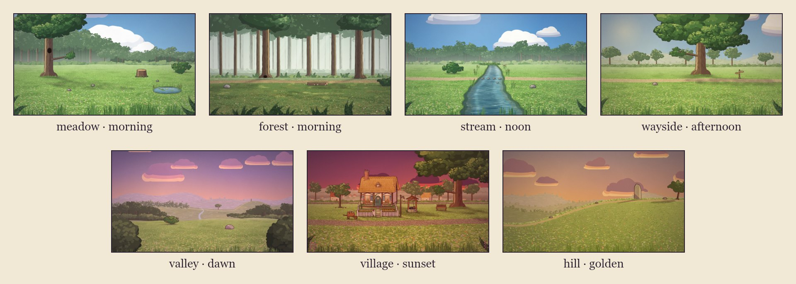

# Sets: kits, anchors and times of day

A **kit** is a painted location: parallax layers of sky, far land and ground, props that sort in depth with the
actors (a character behind a tree is hidden by it), named **anchors** where actors stand, a walkable region the
actors route through, water and stepping stones, and the ambience it sounds like. A film names the kits it uses in
`sets` and each scene picks one:

```json
"sets": { "meadow": { "kit": "meadow" }, "home": { "kit": "village" } },
"scenes": [ { "id": "s01", "set": "meadow", "time": "dawn", … } ]
```



Everything an actor can touch (ground, stump tops, branches, hollows, stones, water) is defined once, as data, and
both the painting and the staging read that same data, so an actor sent to `stump_top` stands on the painted stump.

## Seeing a kit

```sh
node bin/cinecode.mjs set-sheet meadow,stream      # → out/set-sheet.jpg
node bin/cinecode.mjs set-sheet films/my-film      # every kit, including the film's own → films/my-film/out/
```


Each anchor is labelled with its name, the first letter of its type and the actor scale there (`s1.38`); the tick
above it is a standing hare's height at that spot. Red ellipses are solid footprints, the dashed green line bounds
the walkable region, blue outlines are water, teal ellipses are stepping stones, and a yellow polyline is the kit's
sample route when it has one. The skill's inventory script prints the anchors as Markdown tables:
`node .claude/skills/cinecode/scripts/inventory.mjs sets`.

## Coordinates and scale

Set coordinates are world pixels; `y` grows downward, so a bigger `y` is nearer the camera. Actors get bigger toward
the camera: on a flat kit `scale = baseS × (y − horizon) / (laneY − horizon)`, about 1.3 on most kits' main lane
(the `scale` column in the anchor tables is that number at the anchor). A ridge kit (the hill) has a slope instead of a
flat floor: actors walk a band just below the crest line, so give places as `x:…` without `y`.

Places in a storyboard are anchors, `x:1500` (that x on the main lane), `x:1500,y:1060`, or relative to an actor
(`near:fox`); see [storyboard.md](storyboard.md#places). The camera centre is limited to the kit's view, and a frame
never shows past the painted area.

## Anchor types

| type | meaning |
|---|---|
| `ground` | a spot on the ground. An actor sent here stands on it, or on the nearest walkable spot that is not inside a solid prop or another actor. |
| `surface` | the top of a prop (a stump, a rock, a bench seat, a stepping stone). Walking there walks to the foot of the prop and jumps up; leaving jumps down first. Fliers fly there. Stepping stones are also hopped across on routes over water. |
| `perch` | a point on a branch, for rigs that perch (owl, songbird, squirrel, butterfly). Fliers fly there; the squirrel jumps up from the foot of the tree. Others are warned. |
| `hollow` | an opening in a prop (the owl's hollow, the fox's den), see below. |
| `view` | a far landmark (the valley's): frame it with the camera's `on`, or `look` at it. Not a place to stand. |

Any anchor can be a camera subject (`"on": ["den"]`): it is framed as a box of about 120 × 110 world px (× the scale
there), roughly a standing hare, so a small actor framed together with an anchor comes out small.

**Hollows.** An actor sent into a hollow (`"do": "run", "to": "den"`) runs to the foot of the prop and jumps up into
the opening (a flier flies in); `enter` with `"from": "den"` appears in it and walks out. Inside, the actor is drawn
clipped to the opening, in front of a dark hole (by day too): by day the occupant stands out against it, at night it shows
only by the scene's `rim` light or a glow you draw. The openings are small and fixed: the forest's `den` is about 60 × 44
world px at the foot of the oak (a mouse, a hedgehog, a frog fit; anything taller is cut by the opening); the meadow's
`owl_hollow` is about 68 × 92 px, 360 px up the owl tree (for the owl, or another flier). The nearest ground is right
in front of the prop: give it with a `y` (in front of the den, about `x:1490–1550,y:1028`); `x:` alone is the main
lane, further down. A two-shot of someone in a hollow and someone on the ground in front of it works for small rigs
(the den sits about 30 px above that ground); the owl's hollow is too high for one: cut between them.

## Times of day

Every kit paints all eight skies: `dawn`, `morning`, `noon`, `afternoon`, `golden`, `sunset`, `twilight`, `night`.
A scene sets one with `time`, or a change `{ "from": "golden", "to": "twilight" }` blended over the middle 80% of the
scene; a shot can set its own (a time-lapse). Without `time` a scene uses the kit's default.

The time of day is a sky and a grade over the whole picture: a soft-light wash, a multiply tint, a vignette and film
grain. Dawn turns the land rose-gold, golden hour warm, twilight lavender; night is moonlit blue with a contrast
stretch so close-ups keep real darks, and at night a close shot's vignette closes in around its subject. The sun
casts every grounded figure's and solid prop's shadow across the ground, short at noon and long at dawn, golden hour
and sunset; there are no cast shadows at twilight and night. Story grades (`memory`, `dream`) go on top
([storyboard.md](storyboard.md#scenes)).

## Ambience

With `"ambience": "auto"` (the default) a scene plays its kit's day bed, or its night bed at `twilight` and `night`;
a scene that changes between the two switches beds at its midpoint. The beds are synthesized
([sound.md](sound.md#ambience)): `meadow-day`, `meadow-night`, `forest-day`, `forest-night`, `stream`,
`village-day`, `village-night`, `wind-hill`.

## The kits

Kits take one param, `seed` (`"params": { "seed": 2 }`), which changes the random details of the painting.

### forest

A dirt path winding left to right between big trunks, misty depths behind; an old oak with a den between its roots, a fallen log, a mossy boulder, dappled light on the floor.

- **size:** 4400 × 1400 world px; camera centre x 700–3700, y 380–1350; horizon y 720, main lane y ≈ 1066
- **default time:** `morning`; **ambience:** `forest-day` by day, `forest-night` at twilight and night
- **ground:** grass, dirt
- **solid props** (actors route around them; lint flags standing inside one): `oak`, `elm`, `log`, `boulder`, `brambles`

| anchor | type | x | y | scale |
|---|---|---|---|---|
| `path_west` | ground | 700 | 1066 | 1.32 |
| `path_mid` | ground | 2100 | 1066 | 1.31 |
| `path_east` | ground | 3500 | 1057 | 1.28 |
| `oak_front` | ground | 1560 | 1090 | 1.41 |
| `log_front` | ground | 2420 | 1185 | 1.77 |
| `clearing` | ground | 1900 | 1190 | 1.79 |
| `fern_corner` | ground | 3300 | 1230 | 1.94 |
| `boulder_side` | ground | 980 | 1160 | 1.67 |
| `den` | hollow (on `oak`) | 1488 | 995 | 1.08 |
| `log_top` | surface (on `log`) | 2400 | 1074 | 1.53 |
| `boulder_top` | surface (on `boulder`) | 812 | 1112 | 1.71 |

### hill

A long grassy slope rising left to right to a crest with an old standing stone, a hawthorn beyond it, hazy ranges behind. At night the hill re-lights itself for the moon: the slope sinks into cool shadow, the crest keeps a moonlit rim and the standing stone is the brightest shape on the land.

- **size:** 3300 × 1500 world px; camera centre x 800–2900, y 350–1250; a ridge set: the ground follows the slope, so give `x:` only
- **default time:** `golden`; **ambience:** `wind-hill` by day, `meadow-night` at twilight and night
- **ground:** grass, dirt
- **solid props** (actors route around them; lint flags standing inside one): `standing_stone`, `rock_low`, `rock_mid`, `rock_high`, `hawthorn`

| anchor | type | x | y | scale |
|---|---|---|---|---|
| `hill_foot` | ground | 250 | 1227 | 1.40 |
| `slope_low` | ground | 800 | 1143 | 1.40 |
| `slope_mid` | ground | 1400 | 938 | 1.40 |
| `slope_high` | ground | 1900 | 818 | 1.40 |
| `crest` | ground | 2200 | 797 | 1.40 |
| `stone_front` | ground | 2420 | 807 | 1.45 |
| `stone_left` | ground | 2290 | 789 | 1.38 |
| `stone_right` | ground | 2560 | 781 | 1.38 |
| `beyond` | ground | 2860 | 792 | 1.43 |
| `thorn_shade` | ground | 3060 | 784 | 1.40 |
| `stone_top` | surface (on `standing_stone`) | 2426 | 501 | 1.32 |

### meadow

The meadow at the forest edge: an owl's hollow tree with a low branch on the left, an old stump on the right, a small lily pond in the right foreground, the forest wall behind opening onto far hills.

- **size:** 2800 × 1500 world px; camera centre x 500–2300, y 300–1400; horizon y 700, main lane y ≈ 1036
- **default time:** `morning`; **ambience:** `meadow-day` by day, `meadow-night` at twilight and night
- **ground:** grass; water (1 area)
- **solid props** (actors route around them; lint flags standing inside one): `owl_tree`, `stump`, `rock_a`, `rock_b`, `rock_c`, `bush`

| anchor | type | x | y | scale |
|---|---|---|---|---|
| `tree_foot` | ground | 640 | 1050 | 1.34 |
| `stump_front` | ground | 2050 | 1075 | 1.43 |
| `stump_side` | ground | 1880 | 1012 | 1.19 |
| `meadow_centre` | ground | 1400 | 1060 | 1.38 |
| `meadow_left` | ground | 950 | 1050 | 1.34 |
| `meadow_right` | ground | 1760 | 1090 | 1.49 |
| `far_meadow` | ground | 1300 | 900 | 0.76 |
| `foreground` | ground | 1550 | 1260 | 2.14 |
| `pond_edge` | ground | 2200 | 1200 | 1.91 |
| `pond_far` | ground | 2560 | 1140 | 1.68 |
| `bush_side` | ground | 2540 | 960 | 0.99 |
| `rock_top` | surface (on `rock_a`) | 1196 | 1150 | 1.84 |
| `owl_hollow` | hollow (on `owl_tree`) | 436 | 604 | 1.20 |
| `low_branch` | perch (on `owl_tree`) | 650 | 672 | 1.20 |
| `branch_tip` | perch (on `owl_tree`) | 780 | 652 | 1.20 |
| `stump_top` | surface (on `stump`) | 2050 | 901 | 1.20 |

### stream

A brook winding from the far meadow toward the viewer, cutting a path in two. Four stepping stones cross it (a stride apart for a hare, too far for a tortoise: routes hop across them), a frog's rock sits mid-stream, reeds and sedge line the banks. The water moves every frame.

- **size:** 2800 × 1400 world px; camera centre x 700–2100, y 420–1350; horizon y 700, main lane y ≈ 1045
- **default time:** `morning`; **ambience:** `stream` by day, `stream` at twilight and night
- **ground:** grass, dirt; water (1 area); stepping stones `stone_1`, `stone_2`, `stone_3`, `stone_4`, `frog_rock`
- **solid props** (actors route around them; lint flags standing inside one): `bank_rock`, `willow_bush`

| anchor | type | x | y | scale |
|---|---|---|---|---|
| `bank_left` | ground | 1000 | 1052 | 1.31 |
| `bank_right` | ground | 1660 | 1054 | 1.31 |
| `path_west` | ground | 500 | 1055 | 1.32 |
| `path_east` | ground | 2300 | 1055 | 1.32 |
| `near_left` | ground | 860 | 1230 | 1.97 |
| `near_right` | ground | 1880 | 1250 | 2.04 |
| `far_bank` | ground | 1640 | 900 | 0.74 |
| `stone_1` | surface (on `stone_1`) | 1170 | 1043 | 1.27 |
| `stone_2` | surface (on `stone_2`) | 1270 | 1046 | 1.29 |
| `stone_3` | surface (on `stone_3`) | 1370 | 1043 | 1.27 |
| `stone_4` | surface (on `stone_4`) | 1470 | 1046 | 1.29 |
| `frog_rock` | surface (on `frog_rock`) | 1430 | 1116 | 1.55 |

### valley

A lookout knoll above a wide valley: the forest's edge on the left, a stream winding down through the meadows, the path, the wayside tree and the hill with its standing stone far off on the right. For openings, journeys seen from afar and night skies. Its `view` anchors are those far landmarks.

- **size:** 2800 × 1400 world px; camera centre x 1000–1800, y 450–1150; horizon y 600, main lane y ≈ 1072
- **default time:** `dawn`; **ambience:** `meadow-day` by day, `meadow-night` at twilight and night
- **ground:** grass
- **solid props** (actors route around them; lint flags standing inside one): `lookout_rock`, `gorse`

| anchor | type | x | y | scale |
|---|---|---|---|---|
| `lookout` | ground | 1400 | 1200 | 1.00 |
| `knoll_left` | ground | 1060 | 1190 | 0.98 |
| `knoll_right` | ground | 2080 | 1250 | 1.08 |
| `path_down` | ground | 1440 | 1330 | 1.22 |
| `near` | ground | 1250 | 1360 | 1.27 |
| `view_forest` | view | 500 | 860 | 0.43 |
| `view_stream` | view | 1380 | 960 | 0.60 |
| `view_tree` | view | 1680 | 858 | 0.43 |
| `view_stone` | view | 2260 | 733 | 0.22 |
| `lookout_rock` | surface (on `lookout_rock`) | 1866 | 1170 | 1.07 |

### village

A timber-and-plaster cottage under a thatched roof, a cottage garden behind a white picket fence with an open gate, a flagstone path to the door, a stone well, a bench under an old tree with a low branch, a lantern post by the gate and a cobbled lane; beyond a dry-stone wall, neighbours' cottages and a far village with a church spire. At dusk the windows and the lantern light up.

- **size:** 2800 × 1500 world px; camera centre x 600–2300, y 300–1350; horizon y 660, main lane y ≈ 1179
- **default time:** `morning`; **ambience:** `village-day` by day, `village-night` at twilight and night
- **ground:** grass, stone, gravel
- **solid props** (actors route around them; lint flags standing inside one): `cottage`, `bed_left`, `bed_right`, `fence_left`, `gate_post_l`, `gate_post_r`, `fence_right`, `fence_side_l1`, `fence_side_l2`, `fence_side_r1`, `fence_side_r2`, `well`, `bench`, `lantern`, `tree`, `apple_tree`, `wheelbarrow`

| anchor | type | x | y | scale |
|---|---|---|---|---|
| `door_front` | ground | 1050 | 904 | 0.76 |
| `gate` | ground | 1050 | 1098 | 1.36 |
| `garden_path` | ground | 1050 | 990 | 1.02 |
| `window_left` | ground | 862 | 904 | 0.76 |
| `window_right` | ground | 1210 | 904 | 0.76 |
| `lantern_foot` | ground | 1510 | 1094 | 1.34 |
| `well_side` | ground | 1522 | 1000 | 1.05 |
| `well_front` | ground | 1650 | 1050 | 1.21 |
| `bench_front` | ground | 2160 | 1008 | 1.08 |
| `tree_foot` | ground | 2310 | 950 | 0.90 |
| `lane_west` | ground | 300 | 1174 | 1.59 |
| `lane_mid` | ground | 1400 | 1179 | 1.61 |
| `lane_east` | ground | 2500 | 1152 | 1.52 |
| `orchard` | ground | 560 | 940 | 0.87 |
| `meadow_back` | ground | 1900 | 880 | 0.68 |
| `foreground` | ground | 1500 | 1300 | 1.98 |
| `chimney_top` | surface (on `cottage`) | 841 | 248 | 0.68 |
| `roof_ridge` | surface (on `cottage`) | 1143 | 356 | 0.68 |
| `well_rim` | surface (on `well`) | 1628 | 943 | 1.05 |
| `bench_seat` | surface (on `bench`) | 2160 | 909 | 0.93 |
| `bench_left` | surface (on `bench`) | 2110 | 909 | 0.93 |
| `bench_right` | surface (on `bench`) | 2210 | 909 | 0.93 |
| `low_branch` | perch (on `tree`) | 2254 | 610 | 0.76 |
| `branch_tip` | perch (on `tree`) | 2109 | 607 | 0.76 |

### wayside

A great old tree beside the path, a long low branch reaching left over a shady nap spot among its roots, a signpost at the fork, open meadow and soft hills beyond.

- **size:** 2800 × 1500 world px; camera centre x 700–2200, y 350–1350; horizon y 720, main lane y ≈ 1075
- **default time:** `morning`; **ambience:** `meadow-day` by day, `meadow-night` at twilight and night
- **ground:** grass, dirt
- **solid props** (actors route around them; lint flags standing inside one): `way_tree`, `signpost`, `mile_stone`

| anchor | type | x | y | scale |
|---|---|---|---|---|
| `nap` | ground | 1390 | 1014 | 1.06 |
| `tree_shade` | ground | 1200 | 1030 | 1.12 |
| `roots_front` | ground | 1600 | 1040 | 1.16 |
| `path_west` | ground | 500 | 1086 | 1.32 |
| `path_mid` | ground | 1400 | 1075 | 1.28 |
| `path_east` | ground | 2400 | 1084 | 1.32 |
| `sign` | ground | 2160 | 1095 | 1.35 |
| `meadow_near` | ground | 1300 | 1240 | 1.88 |
| `far_field` | ground | 2000 | 930 | 0.76 |
| `way_branch` | perch (on `way_tree`) | 1310 | 600 | 0.96 |
| `branch_end` | perch (on `way_tree`) | 1128 | 597 | 0.96 |
| `branch_base` | perch (on `way_tree`) | 1447 | 622 | 0.96 |

## Adding a kit

A film can bring its own locations in `custom.mjs`: export `kits` as `{ name: (params) => set }` and use the name as a
set's `kit`. `makeSet` from `engine/set/set.mjs` builds the set from a description. This example is a complete,
working kit: a meadow glade with far hills and one boulder you can stand on.

```js
// films/<slug>/custom.mjs
import { makeSet } from '../../engine/set/set.mjs';

const ground = x => 1000 + 12 * Math.sin(x / 300);    // the lane where actors stand by default (y at x)

export const kits = {
  glade: () => makeSet({
    id: 'glade', W: 2400, H: 1400, refX: 1200, refY: 800,
    area: { x0: -300, x1: 2700, y0: -300, y1: 1600 },  // the painted world: no frame shows past it
    view: { x0: 700, x1: 1700, y0: 350, y1: 1200 },      // where the camera centre may go
    horizon: 700, laneY: 1000, baseS: 1.3, lane: ground,  // scale = baseS × (y − horizon) / (laneY − horizon)
    layers: [
      { k: 0.5, paint(x, r, S, E) {                       // far hills: parallax 0.5
        x.fillStyle = '#9fb8a6'; x.beginPath(); x.moveTo(E.x0, 760);
        for (let px = E.x0; px <= E.x1; px += 40) x.lineTo(px, 690 - 40 * Math.sin(px / 260));
        x.lineTo(E.x1, 760); x.lineTo(E.x1, E.y1); x.lineTo(E.x0, E.y1); x.closePath(); x.fill();
      } },
      { k: 1, paint(x, r, S, E) {                         // the ground the actors stand on
        x.fillStyle = '#7da35a'; x.fillRect(E.x0, 720, E.x1 - E.x0, E.y1 - 720);
        for (let i = 0; i < 900; i++) { x.fillStyle = r() < 0.5 ? '#6f9550' : '#8db068'; x.fillRect(E.x0 + r() * (E.x1 - E.x0), 730 + r() * 900, 14, 4); }
      } },
    ],
    props: [{
      id: 'boulder', x: 1500, y: 1030, solid: { rx: 70, ry: 20 }, bounds: [1420, 950, 1580, 1040],
      paint(x) { x.fillStyle = '#8a8478'; x.beginPath(); x.ellipse(1500, 1030, 80, 70, 0, Math.PI, 0); x.fill(); },
      anchors: { boulder_top: { x: 1500, y: 962, type: 'surface' } },
    }],
    anchors: {
      west: { x: 900, y: 1000 }, east: { x: 1750, y: 1010 },
      centre: { x: 1200, y: 1020 }, front: { x: 1250, y: 1180 },
    },
    ambience: { day: 'meadow-day', night: 'meadow-night' },
  }),
};
```

```json
"sets": { "glade": { "kit": "glade" } }
```

The description:

| field | meaning |
|---|---|
| `id`, `W`, `H` | the kit's name and its nominal size in world pixels |
| `area` | the painted world `{ x0, x1, y0, y1 }` (default 0..W, 0..H). A frame never shows past it: the camera zooms in instead (the widest view any camera shows is 3200 × 1800 world px). |
| `view` | where the camera centre may go |
| `refX`, `refY` | the reference camera centre: parallax offsets are measured from it |
| `horizon`, `laneY`, `baseS`, `lane(x)` | perspective: the actor scale is `baseS` on the lane y and 0 at the horizon. `lane(x)` gives the main lane's y at x (default `laneY`). `scaleAt(x, y)` may replace the formula. |
| `layers` | `[{ k, paint(ctx, rnd, S, E), front, outline, anim }]`. `k` is the parallax factor (0.5 = far, 1 = the ground, > 1 or `front: true` = drawn in front of the actors). `paint` draws once in world coordinates inside the extent `E` (`{ x0, x1, y0, y1 }`) with the seeded random `rnd()`; the result is cached. `outline: { w, color, alpha }` inks the layer's silhouette. `anim(ctx, t)` draws moving parts every frame (water shimmer). |
| `props` | `[{ id, x, y, solid: { rx, ry }, bounds: [x0, y0, x1, y1], paint(ctx, rnd, S), anchors, top }]`: things that sort in depth with the actors by `y`. `solid` is the footprint ellipse actors route around. `bounds` is a hint of where it paints. `anchors` on a prop belong to it (a surface on its top). |
| `anchors` | `{ name: { x, y, type, depth, face, clip, branch, at, s, surface } }`; type defaults to `ground`, `y` to the lane. For a `perch`, `branch: { pts, w0, w1 }` and `at` (0..1 along it). For a `hollow`, `clip` is the opening's polygon. `face` is the facing an actor placed there takes; `s` overrides the scale there; `surface` the footstep sound. |
| `walk` | `{ region, ground, band, water, stones, paths }`: `region` the walkable polygon (default: the whole area); `ground(x)` and `band` make a ridge set; `water` a list of polygons; `stones` prop ids whose `top` ellipse (`{ x, y, rx, ry }`) can be stood on in water; `paths` `[{ poly, surface }]`: ground with its own footstep sound (`surface` defaults to `dirt`). |
| `surface` | the footstep surface everywhere else (default `grass`) |
| `sampleRoute` | `[from, to]`, anchor names or `[x, y]` points: a route drawn on the set sheet |
| `light` | the light direction for ink and shading (default from the upper left) |
| `defaultSky` | the time of day when a scene gives none (default `morning`) |
| `ambience` | `{ day, night }` bed names for `"ambience": "auto"` |

Paint in the house style with the helpers in `engine/paint/` (`nature.mjs`: trees, foliage, grass; `scenery.mjs`:
ridges, meadow floors, tree lines; `water.mjs`; `structures.mjs`: cottages, fences, walls; `atmos.mjs`: paper
texture, haze, mist; `brush.mjs`: gouache dabs and ink) and look at `engine/set/kits/meadow.mjs` for a full kit. Use
the random function you are given, never `Math.random()`, so every render paints the same picture. Check a new kit
with `node bin/cinecode.mjs set-sheet films/<slug> <name>`: anchors, solid footprints, the walk region and water are
drawn over it. A kit for every film belongs in `engine/set/kits/<name>.mjs` (registered automatically under its file
name) with a test in `test/sets.test.mjs`.
